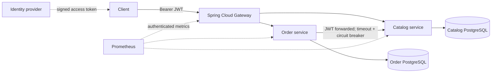

# Spring Cloud Commerce Reference

A complete Java reference project for learning how business services, Docker images, shell automation, and Kubernetes deployments fit together. The example creates orders from catalog prices; it demonstrates production engineering patterns in a deliberately small domain.

**Stack:** Java 21, Spring Boot 4.1.1, Spring Cloud 2025.1.3, Spring Cloud Gateway, Spring Cloud CircuitBreaker / Resilience4j, Spring Security JWT resource servers, JDBC, Flyway, PostgreSQL, Actuator and Prometheus metrics. Versions are pinned in the Maven parent and Cloud BOM.

This is an enterprise-oriented reference, not a claim that a demo is ready for your company's production traffic. The production overlay requires your identity provider, managed databases, image registry, TLS and operational controls. See [deployment guide](docs/DEPLOYMENT.md) and [design notes](docs/ARCHITECTURE.md).

## Architecture



Kubernetes Services provide DNS discovery and load balancing. ConfigMaps and Secrets provide environment configuration. This design does not need a separate registry server or Config Server; Spring Cloud supplies routing and circuit breaking.

| Directory | Purpose |
|---|---|
| `gateway/` | Reactive gateway, route authorization, downstream timeouts |
| `catalog-service/` | Bounded product listing and lookup; owned database |
| `order-service/` | Price lookup, validation, customer ownership, atomic idempotency |
| `security-common/` | Shared issuer, audience, expiry and subject validation |
| `Dockerfile`, `compose.yaml` | Multi-stage Java images and local five-container environment |
| `k8s/base/` | Deployments, Services, probes, resource limits, ingress network policies |
| `k8s/overlays/demo/` | Single replicas and two PostgreSQL StatefulSets with PVCs |
| `k8s/overlays/production/` | External databases, autoscaling, disruption budgets and spreading |
| `scripts/` | Credentials, token generation, builds, smoke tests, deployment and rollback |
| `scripts/check-publication.py` | Checks indexed files for private paths, credentials and generated output |
| `.github/workflows/ci.yaml` | Java tests, real PostgreSQL concurrency test, shell checks and Compose smoke test |

## Start with Docker

Install Docker Engine + Compose v2, or Docker Desktop in **Linux containers** mode, and Python 3. Allow roughly 4 GB of memory for the stack, plus build headroom. Internet access is needed on the first build. Java and Maven on the host are optional when using Docker.

Clone the repository from any working directory:

```bash
git clone https://github.com/Deamenophobia/springcloud-enterprise-demo.git
cd springcloud-enterprise-demo
```

Alternatively, download the source archive from GitHub. No machine-specific checkout location is required.

From the project's root directory on Linux/macOS/WSL:

```bash
bash scripts/local-up.sh
```

This creates random demo credentials in `.env` without replacing an existing file, builds the three images, waits for health checks, and runs the smoke test.

On Windows PowerShell, after cloning or extracting the repository (start in its parent directory):

```powershell
cd springcloud-enterprise-demo
python scripts/init-env.py
docker compose up --build --wait --wait-timeout 300
python scripts/smoke-test.py
```

Only the gateway is published, at `http://localhost:8080`. PostgreSQL and application management ports stay inside the Compose network. The bind address is loopback.

Inspect or stop:

```bash
docker compose ps
docker compose logs -f order-service
bash scripts/local-down.sh
```

`docker compose down` preserves data. Deleting volumes is a separate, destructive operation; it is not performed by the supplied scripts. Keep `.env` with existing volumes: changing the password variable does not change a database password already stored in a volume.

## Try the API

Linux/macOS/WSL:

```bash
TOKEN="$(python3 scripts/demo-token.py)"
curl -fsS -H "Authorization: Bearer $TOKEN" http://localhost:8080/api/products
curl -i http://localhost:8080/api/orders \
  -H "Authorization: Bearer $TOKEN" \
  -H "Content-Type: application/json" \
  -H "Idempotency-Key: tutorial-order-001" \
  -d '{"sku":"KEYBOARD-001","quantity":2}'
```

PowerShell:

```powershell
$token = python scripts/demo-token.py
$headers = @{ Authorization = "Bearer $token"; "Idempotency-Key" = "tutorial-order-001" }
Invoke-RestMethod http://localhost:8080/api/products -Headers $headers
$order = Invoke-RestMethod http://localhost:8080/api/orders -Method Post -Headers $headers -ContentType application/json -Body '{"sku":"KEYBOARD-001","quantity":2}'
Invoke-RestMethod "http://localhost:8080/api/orders/$($order.id)" -Headers $headers
```

A new order returns **201**, a `Location` header, and a total of **178.00 USD**. Sending the same body and key again returns **200**, the same order ID, and `Idempotency-Replayed: true`. Changing the body while reusing the key returns **409**.

| Endpoint | Required scope | Behavior |
|---|---|---|
| `GET /api/products?limit=20&offset=0` | `catalog.read` | Limit 1–100; offset 0–100000 |
| `GET /api/products/{sku}` | `catalog.read` | 404 when the product is missing |
| `POST /api/orders` | `orders.write`, plus `catalog.read` for new orders | Requires `Idempotency-Key`; quantity 1–100 |
| `GET /api/orders/{id}` | `orders.read` | Only the JWT subject who created the order can read it |
| `GET :9090/actuator/health/liveness` | None | Process health |
| `GET :9090/actuator/health/readiness` | None | Service readiness; includes database health for business services |
| `GET :9090/actuator/prometheus` | `metrics.read` | Internal metrics; not routed by the gateway |

All API routes require a signed JWT. Demo tokens last 15 minutes. The `demo-token.py` utility is strictly for local/demo signing; production accepts tokens from your external identity provider.

## Build and test the Java code

Install JDK 21 and Maven 3.9+:

```bash
mvn -B -ntp verify
```

Tests cover signed JWT rejection, HTTP authentication and scopes, request validation, server-side pricing, replay/conflicts, customer ownership, and gateway startup. The PostgreSQL integration profile additionally tests actual SQL migrations, record mapping and eight concurrent idempotent requests:

```bash
export TEST_DATABASE_URL=jdbc:postgresql://localhost:5432/orders_it
export TEST_DATABASE_USER=test
export TEST_DATABASE_PASSWORD=your_test_database_password
mvn -B -ntp -Ppostgres-it verify
```

Use a dedicated test database whose user can create schemas. The integration test creates a uniquely named schema and removes only that schema. CI provisions this database automatically. The normal test run does not silently pretend the database integration test ran.

For host Java debugging, use the configuration table in [the deployment guide](docs/DEPLOYMENT.md#configuration) and run each packaged JAR with its own port; the default internal application port is 8080 for every service.

## Build images and deploy to Kubernetes

Use Bash/WSL, `kubectl`, Python 3, a running cluster, and a registry the nodes can pull from.

```bash
# Replace registry and tag with values you own.
bash scripts/build-images.sh registry.example.com/team/commerce v1.0.0 --push
kubectl config get-contexts
python3 scripts/init-env.py

# Explicit context prevents accidentally using a different selected cluster.
bash scripts/deploy.sh demo YOUR_CONTEXT registry.example.com/team/commerce v1.0.0 .env
kubectl --context YOUR_CONTEXT -n commerce-demo port-forward service/gateway 8080:8080

# In a second terminal:
python3 scripts/smoke-test.py
```

The demo needs a default StorageClass for PVCs. Private registries need image-pull credentials configured in the namespace. For kind, loading locally built images is also supported; see [step-by-step deployment](docs/DEPLOYMENT.md).

For production, customize `.env.production.example`, provision the external dependencies, then use the `production` overlay. [Production deployment and rollback](docs/DEPLOYMENT.md#production-deployment) explains the prerequisites and commands.

## Suggested learning order

1. Follow a request through `gateway/src/main/resources/application.yaml`.
2. Read `OrderController`, `OrderService`, `OrderRepository`, and the Flyway migration together.
3. Compare the Dockerfile build stage with its runtime stage.
4. Compare Compose services with Kubernetes Deployments, Services and StatefulSets.
5. Read `deploy.sh` and `rollback.sh`, then practice on a disposable cluster.
6. Stop `catalog-service` in Compose: new orders should return 503; replaying an already-created order should still succeed. Start it again and allow the circuit breaker to recover.

## Sources and verification

The stack follows [Spring Cloud's compatibility table](https://spring.io/projects/spring-cloud/) and [Spring Boot's Java requirements](https://docs.spring.io/spring-boot/system-requirements.html). See [verification record](docs/VERIFICATION.md) for what was actually run on the authoring machine.

## Contributing and publishing

See [contribution instructions](CONTRIBUTING.md) and [public repository preparation](docs/PUBLISHING.md).
