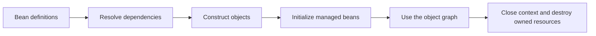

# 1. The Spring container: object ownership you can test

An order service needs a repository, a catalog client and a transaction boundary. In the commerce application those dependencies appear in the `OrderService` constructor. Before the first request arrives, something must find appropriate collaborators, construct the service and make the resulting object available. This chapter examines that assembly process.

Our evidence is [BeanContainerTest](../../framework-labs/src/test/java/com/example/commerce/labs/BeanContainerTest.java). It uses real `AnnotationConfigApplicationContext` instances without a web server, database or `@SpringBootTest`.

```bash
mvn -B -ntp -pl framework-labs -Dtest=BeanContainerTest clean test
```

This focused command runs seven tests. For the complete evidence report, run the full laboratory command in [the series guide](README.md); the reporter intentionally rejects reports with missing suites.

## From a definition to a usable object

The test supplies registrations to a context, then calls `refresh()`. Registrations describe what the context can construct; the resulting beans are actual objects. In these experiments the context resolves constructor or factory-method dependencies, initializes its singleton objects and makes them available for lookup. Closing the context triggers the configured destruction callback in our lifecycle fixture.



This is a simplified path through these fixtures, not a complete lifecycle diagram: post-processors, lazy beans and scoped proxies can add steps. The distinction matters when explaining a real service; a constructor breakpoint alone does not reveal all framework behavior.

## Experiment: choose a collaborator, then remove that choice

`qualifierSelectsTheIntendedConstructorDependency` registers two implementations of `PaymentPort`, called `card` and `invoice`. The checkout constructor requests the card implementation:

```java
QualifiedCheckout(@Qualifier("card") PaymentPort port) {
    this.port = port;
}
```

The test verifies both object identity and behavior: the injected reference is the registered card bean and `pay()` returns `card`. That is stronger than checking that a field is non-null.

The companion experiment, `ambiguousDependencyPreventsContextStartup`, uses a constructor with no qualifier and no preferred candidate. Refresh fails with a root cause of `NoUniqueBeanDefinitionException`, and the context is inactive. The startup warning is the intended observation. A test that only constructs `new QualifiedCheckout(fake)` could check checkout logic, but would never exercise Spring's candidate resolution.

For an enterprise application, this becomes relevant when a second adapter is introduced: two payment gateways, two data sources, or two notification implementations. Tests should capture the application's intended selection instead of letting accidental registration changes choose it. See Spring's [qualifier documentation](https://docs.spring.io/spring-framework/reference/core/beans/annotation-config/autowired-qualifiers.html) for the broader selection rules.

## Experiment: scope belongs to lookup, not to every method call

`providerResolvesNewPrototypesInsideOneSingleton` creates one checkout with a directly injected prototype `Task` and an `ObjectProvider<Task>`. Looking up the checkout again returns the same checkout and its same originally injected task. Calling the provider twice returns two different tasks.

The assertions distinguish an object supplied at construction from a dependency requested later. They do not use timestamps, sleeps or hash-code strings to infer identity. This prevents a common misunderstanding: placing a prototype inside a singleton does not cause that field to refresh each time the singleton is used. Spring documents the [singleton/prototype interaction](https://docs.spring.io/spring-framework/reference/core/beans/factory-scopes.html).

The commerce services keep request-specific data in method arguments and local variables. That design is easier to inspect than mutable request state on a shared service object. This scope experiment does not establish thread safety: a singleton can still contain unsafe mutable fields, and a separate concurrency test would be needed for such a claim.

## Experiment: ownership includes cleanup

`containerInitializesAndDestroysItsSingleton` records three events. Before the context closes, the list contains `constructed` and `started`. After it closes, `stopped` appears exactly once. The test retains the list outside the context so cleanup is observable after shutdown.

This fixture uses explicit init and destroy method names; it is not a test of every lifecycle annotation or of prototype cleanup. Its enterprise connection is resource ownership: a component that creates a connection pool or worker must have a defined shutdown path. The callback contract is described in Spring's [lifecycle documentation](https://docs.spring.io/spring-framework/reference/core/beans/factory-nature.html).

## Experiment: a factory-method call can create an extra object

The last three tests compare otherwise similar configurations:

| Configuration | How the holder obtains its dependency | Verified identity |
|---|---|---|
| `@Configuration` | Calls another `@Bean` method | Same as the managed dependency |
| `@Configuration(proxyBeanMethods = false)` | Calls another `@Bean` method | Different from the managed dependency |
| `@Configuration(proxyBeanMethods = false)` | Accepts dependency as a method argument | Same as the managed dependency |

The second row passes because the assertion deliberately expects the extra object. A passing test can demonstrate an undesirable configuration; “all green” does not mean every illustrated pattern is recommended.

For example, `new Holder(dependency())` in the second configuration executes a regular Java factory call and constructs an additional `Dependency`. Method-argument injection expresses the intended dependency without relying on intercepted calls between factory methods. This distinction follows Spring's [Java configuration model](https://docs.spring.io/spring-framework/reference/core/beans/java/basic-concepts.html).

The configuration proxy in this experiment and the transaction proxy in chapter 3 solve different problems. Both involve interception, but their targets and responsibilities differ. Treating all generated subclasses as the same feature hides the reason a particular call behaves differently.

## Follow the mechanism into commerce

Open [OrderService](../../order-service/src/main/java/com/example/commerce/orders/OrderService.java) and [OrderRepository](../../order-service/src/main/java/com/example/commerce/orders/OrderRepository.java). The constructors expose the dependency path from use case to persistence. In [OrderServiceTest](../../order-service/src/test/java/com/example/commerce/orders/OrderServiceTest.java), ordinary construction supplies mocks to test business choices. The laboratory instead supplies a real context to test object assembly. Both levels answer useful, different questions.

The seven passing experiments demonstrate the fixture behaviors listed above. They do not yet verify component scanning of the whole application, circular dependency handling, request scope, all post-processor ordering, or shutdown under an orchestrator. Those claims require their own experiments.

Next: [How Boot assembles JDBC infrastructure](02-boot-jdbc.md).
