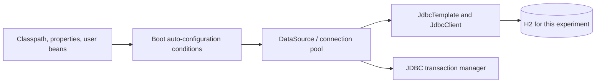

# 2. Spring Boot: test the conditions behind the defaults

In the commerce services, application code receives a `JdbcClient` without constructing a connection pool itself. Spring Framework provides the container and JDBC abstractions; Spring Boot contributes configurations that can assemble them. The useful question is which inputs make those defaults appear, and how an application replaces one piece.

[JdbcAutoConfigurationTest](../../framework-labs/src/test/java/com/example/commerce/labs/JdbcAutoConfigurationTest.java) uses `ApplicationContextRunner` and the real Boot JDBC auto-configurations. These are integration experiments with Boot, HikariCP, Spring JDBC and H2, not mocked SQL calls.

```bash
mvn -B -ntp -pl framework-labs -Dtest=JdbcAutoConfigurationTest clean test
```

## Hold the inputs under control

The runner imports `DataSourceAutoConfiguration`, `JdbcTemplateAutoConfiguration`, `JdbcClientAutoConfiguration` and `DataSourceTransactionManagerAutoConfiguration`. It gives each default embedded database a unique name. Each run owns and closes its context.



This is an explicitly selected set of configurations. It does not exercise Boot's discovery of a custom starter from a packaged JAR. That narrower setup keeps each changed input visible. Spring recommends context runners for [testing auto-configuration](https://docs.spring.io/spring-boot/reference/features/developing-auto-configuration.html).

## Three experiments

| Test | Changed input | Observed assertion |
|---|---|---|
| `bootAssemblesWorkingJdbcInfrastructureFromTheClasspath` | H2 and JDBC dependencies are available | Exactly one data source, JDBC client and transaction manager; `SELECT 42` returns 42 |
| `userDataSourceReplacesOnlyTheDefaultWhileJdbcStillWorks` | Supply an application-owned data source | The context uses that exact instance; a configured JDBC client executes `SELECT 7` |
| `missingJdbcApiDisablesTheConditionalInfrastructure` | Hide Spring JDBC through `FilteredClassLoader` | Context starts without a data source or JDBC client |

The first result establishes working connectivity, not just bean presence. The second establishes that an explicit application choice replaces the data-source default while compatible JDBC configuration continues. The third changes the classloader view deliberately; it is not a test of a corrupted deployment or a missing database driver on a real server.

This gives a practical debugging sequence: inspect what is on the classpath, inspect which beans the application already defines, and inspect the relevant configuration properties and condition report. Adding an annotation without identifying the failed condition is hard to reason about.

## Connection to enterprise infrastructure

The [order-service POM](../../order-service/pom.xml) supplies JDBC, Flyway and PostgreSQL dependencies. Its [configuration](../../order-service/src/main/resources/application.yaml) supplies the environment-specific database connection. `OrderRepository` receives the resulting `JdbcClient`.

The laboratory changes the database implementation to H2 so this assembly experiment runs without Docker or credentials. Its results do not establish PostgreSQL SQL compatibility, migration correctness, TLS configuration, pool sizing or failover. The existing `OrderPersistenceIT` addresses some PostgreSQL persistence behavior separately. Keeping those claims separate makes a useful article: readers can reproduce one mechanism quickly and still understand what a production integration requires.

No H2 dependency is added to the service POMs. The laboratory's dependencies are all test-scoped. Check the root Maven reactor and Dockerfile together when adding such a module: the Docker build needs the laboratory POM to read the reactor, even though a selected service build does not package its tests.

Next: [Which transaction boundary actually executes?](03-transaction-boundaries.md).
