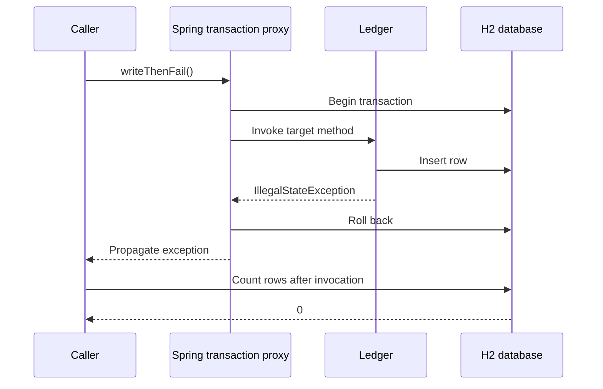

# 3. Transaction boundaries: inspect the data after failure

An annotation in source code does not by itself tell us whether a database transaction executed. We need to observe the call path and the persisted outcome. [TransactionProxyTest](../../framework-labs/src/test/java/com/example/commerce/labs/TransactionProxyTest.java) uses a real Spring proxy, `DataSourceTransactionManager`, `JdbcClient` and an isolated H2 database for each test.

```bash
mvn -B -ntp -pl framework-labs -Dtest=TransactionProxyTest clean test
```

There are six experiments. The test class has **no `@Transactional` annotation**: a test-managed transaction could obscure the very boundary we want to observe. A fixture records whether a transaction was active inside the write method. Row counts are queried after the call has completed, with no active transaction on the test thread.

## Make interception visible

The context enables transaction management with class-based proxies. The test checks `AopUtils.isAopProxy(ledger)` before exercising the bean. The proxied public method inserts one ledger row and then throws an unchecked exception.



`externalCallRollsBackOnUncheckedFailure` observes an active transaction inside the method and zero rows afterward. The method was entered and the insert ran; the persisted effect was rolled back. This is stronger evidence than verifying a mock transaction manager received a `rollback` call.

## Change only the call path

The same bean also has an unannotated `callSelf()` method:

```java
public void callSelf() {
    writeThenFail();
}
```

The caller enters `callSelf()` through the bean reference, but the target's subsequent call to its own method does not cross the transaction proxy. In `selfInvocationBypassesAdviceAndLeavesAnAutocommittedRow`, the fixture records no active transaction and the row count is one despite the exception. This result depends on this fixture: there is no outer transaction and its JDBC connection uses auto-commit outside a managed transaction. An outer transaction would change that outcome.

The repair experiment places the coordinating operation in a separate `Checkout` bean that receives the managed `Ledger`. Its call crosses the collaborator's proxy. `callingAnInjectedCollaboratorRestoresTheTransactionBoundary` observes an active transaction and zero persisted rows after failure.

This illustrates the default proxy-based transaction model. AspectJ weaving is a different mode and is outside these tests. Spring describes the self-invocation boundary and rollback configuration in [its transaction annotation reference](https://docs.spring.io/spring-framework/reference/data-access/transaction/declarative/annotations.html).

## Change the exception policy

The next pair keeps the external call path and changes the rollback rule:

| Fixture method | Exception and rule | Transaction observed? | Rows afterward |
|---|---|---|---|
| `writeThenFail()` | Unchecked exception, default rule | Yes | 0 |
| `callSelf()` | Unchecked exception, no intercepted inner call | No | 1 |
| `Checkout.submit()` | Delegates to proxied `writeThenFail()` | Yes | 0 |
| `checkedFailure()` | `IOException`, default rule | Yes | 1 |
| `checkedFailureWithRollback()` | `IOException`, explicit `rollbackFor` | Yes | 0 |

The checked-exception experiment commits under the default policy used by this configuration. The explicit rollback rule changes the persisted outcome. Applications can configure broader rollback defaults; a claim about a particular enterprise service should identify its effective policy. These tests intentionally retain the default and one explicit override.

An exception being visible to the caller and a transaction being rolled back are different observations. An article should show both. The named assertions let a reader verify the result without trusting a console screenshot.

## Programmatic boundaries in the commerce service

The sixth experiment executes a write and unchecked failure inside `TransactionTemplate`. It confirms an active transaction inside the callback and zero rows afterward without a service proxy. See Spring's [programmatic transaction reference](https://docs.spring.io/spring-framework/reference/data-access/transaction/programmatic.html).

The actual [OrderService](../../order-service/src/main/java/com/example/commerce/orders/OrderService.java) uses this approach. It first checks for an idempotent replay and obtains a catalog quote. It then enters the transaction callback to attempt the insert and resolve a concurrent winner. This placement keeps the remote price lookup outside that write transaction.

The laboratory explains the mechanism; it does not directly prove all of `OrderService`'s behavior. [OrderServiceTest](../../order-service/src/test/java/com/example/commerce/orders/OrderServiceTest.java) checks its business branches with mocks. [OrderPersistenceIT](../../order-service/src/test/java/com/example/commerce/orders/OrderPersistenceIT.java) exercises the real PostgreSQL migration and competing inserts. A later persistence chapter can connect these levels and add more failure scenarios.

## Enterprise conclusions with a defined scope

When reviewing a transactional use case, trace the caller into the actual bean reference, identify the transaction manager and rollback policy, and inspect data after an induced failure. Keep remote operations and database connection ownership visible in the design. Those are concrete engineering questions that this small domain makes reproducible.

The H2 experiments do not validate PostgreSQL isolation, deadlocks, distributed transactions, reactive transaction context, propagation combinations or recovery after a process crash. The six passing results are evidence for the six named scenarios. Expanding the architecture should expand that evidence, rather than simply adding more annotations.

Return to [the series and evidence map](README.md).
